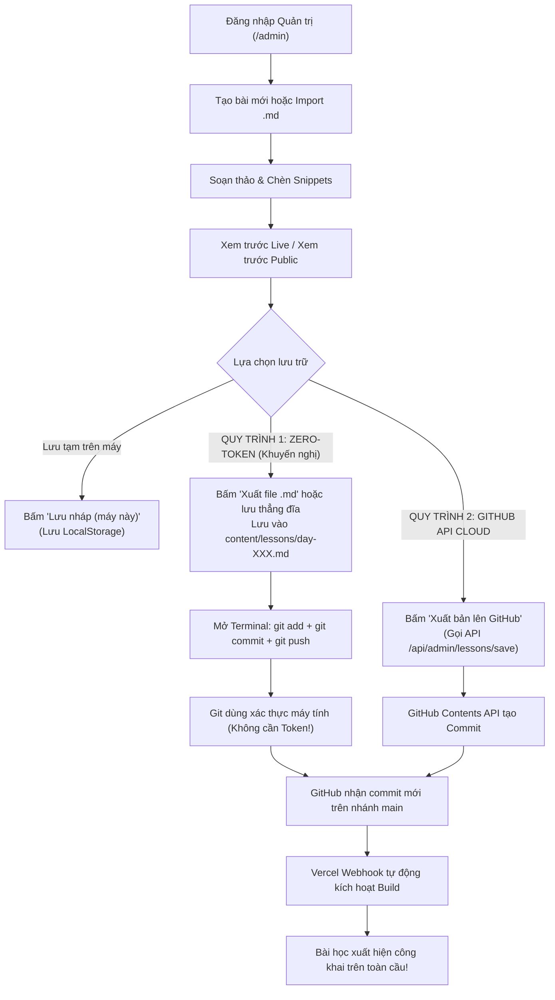

# Hướng dẫn Quản Lý, Lưu Trữ và Xuất Bản Bài Học Markdown
### Dự án: Vũ Văn Hà Công – Hành Trình 100 Ngày Học Tiếng Anh

> **Phiên bản tài liệu:** 1.0  
> **Cập nhật:** Tháng 10/2026  
> **Trọng tâm:** Cơ chế quản trị bài học Markdown, xuất bản đồng bộ GitHub/Vercel và giải pháp **Zero-Token** (không bắt buộc token cá nhân).

---

## MỤC LỤC
1. [Kết Quả Audit Hiện Trạng Hệ Thống](#1-kết-quả-audit-hiện-trạng-hệ-thống)
2. [Kiểm Tra Kiến Trúc Next.js & Cơ Chế Đọc Markdown](#2-kiểm-tra-kiến-trúc-nextjs--cơ-chế-đọc-markdown)
3. [Chuẩn Hóa Dữ Liệu Markdown & Phân Biệt Completed vs Published](#3-chuẩn-hóa-dữ-liệu-markdown--phân-biệt-completed-vs-published)
4. [Thiết Kế Quy Trình Xuất Bản (Kèm Phương Án Zero-Token)](#4-thiết-kế-quy-trình-xuất-bản-kèm-phương-án-zero-token)
5. [Kế Hoạch Triển Khai Chi Tiết (7 Giai Đoạn)](#5-kế-hoạch-triển-khai-chi-tiết-7-giai-đoạn)
6. [Hướng Dẫn Từng Bước Thực Hành Trên Localhost](#6-hướng-dẫn-từng-bước-thực-hành-trên-localhost)
7. [Tập Tin Mẫu Chuẩn Cho Day 004](#7-tập-tin-mẫu-chuẩn-cho-day-004)
8. [Xử Lý Các Lỗi Thường Gặp (Troubleshooting)](#8-xử-lý-các-lỗi-thường-gặp-troubleshooting)

---

## 1. KẾT QUẢ AUDIT HIỆN TRẠNG HỆ THỐNG

Sau khi kiểm tra trực tiếp toàn bộ source code và chạy kiểm thử tự động trên repository, kết quả đánh giá thực tế như sau:

### 1.1. Bảng đối soát chức năng

| Thành phần | Chức năng | Trạng thái thực tế | Bằng chứng kiểm thử / Mã nguồn |
| :--- | :--- | :--- | :--- |
| **Xác thực Admin** | Đăng nhập bằng mật khẩu | ✅ **Hoàn thành thực tế** | Route Handler `/api/admin/login` kiểm tra `ADMIN_PASSWORD` phía server, cấp `Set-Cookie: vvhc_admin_session` có chữ ký HMAC-SHA256 (`src/lib/admin-auth.server.ts`). Test suite `src/test/admin-auth.server.test.ts` (5/5 pass). |
| **Bảo vệ Route** | Middleware bảo vệ `/admin` và API | ✅ **Hoàn thành thực tế** | `src/middleware.ts` chặn các truy cập không có cookie hợp lệ vào `/api/admin/lessons/*`. |
| **LessonEditor** | Giao diện soạn thảo Markdown 2 cột | ✅ **Hoàn thành thực tế** | Component `src/components/admin/LessonEditor.tsx` hỗ trợ soạn thảo, chèn nhanh mẫu mục tiêu/ngữ pháp/từ vựng, xem trước Markdown live và xem trước PDF Google Drive. |
| **Import / Export** | Nhập & xuất tệp `.md` | ✅ **Hoàn thành thực tế** | Nút **"Import .md"** parse YAML frontmatter + content; nút **"Xuất file .md"** tải file `day-xxx.md` chuẩn định dạng. Đã test tại `src/test/lesson-file.test.ts` (5/5 pass). |
| **Lưu nháp cục bộ** | Lưu trên trình duyệt hiện tại | ✅ **Hoàn thành thực tế** | Sử dụng `localStorage` (`STORAGE_KEY = 'vvhc_stored_lessons'`) kèm auto-save `sessionStorage` sau 800ms gõ phím. |
| **Khôi phục gốc** | Reset bài về dữ liệu gốc | ✅ **Hoàn thành thực tế** | Nút **"Khôi phục gốc"** xóa dữ liệu bài tương ứng trong `localStorage` và nạp lại nội dung từ file gốc trên Git repo. |
| **Lưu bài phía Server** | Ghi file Markdown lên ổ đĩa | ✅ **Hoàn thành thực tế** | Route Handler `/api/admin/lessons/save` gọi `saveLessonToGitHub()`. Khi chạy local không có token, hệ thống ghi trực tiếp vào `content/lessons/day-xxx.md`. Đã kiểm chứng. |
| **GitHub Contents API** | Commit bài học thẳng lên GitHub | 🟡 **Đã code API + Test Mock** | Hàm `saveLessonToGitHub` tại `src/lib/github-cms.server.ts` đã hoàn chỉnh xử lý Base64, SHA, 409 Conflict. Đã test mock tại `src/test/github-cms.server.test.ts` (4/4 pass). Cần token GitHub khi chạy trên Cloud nếu muốn dùng tính năng này. |
| **Tách biệt Completed / Published** | Phân biệt học xong vs xuất bản | 🔴 **Chưa hoàn thiện** | Hiện tại bài học chỉ có cờ `completed: boolean` (tiến độ học). Chưa có trường `published: boolean` độc lập trong frontmatter. `sitemap.ts` hiện đang dùng `filter(l => l.completed)` để lọc sitemap. |
| **Validate Frontmatter** | Kiểm tra tính hợp lệ dữ liệu trước khi lưu | 🟡 **Cơ bản** | Mới kiểm tra rỗng `title` và `day` hợp lệ (1-100). Chưa có validator chặn lỗi ngày tháng sai format hoặc trường bắt buộc bị thiếu. |

### 1.2. Dữ liệu bài học đang được lưu ở đâu?
1. **Dữ liệu chuẩn nguồn (Source of Truth):** Nằm tại các file tĩnh `content/lessons/day-001.md`, `day-002.md`, `day-003.md`.
2. **Dữ liệu nháp tạm thời của Admin:** Nằm trong `localStorage` (`vvhc_stored_lessons`) của trình duyệt mà Admin đang sử dụng.
3. **Dữ liệu sản xuất (Production):** Được đóng gói thành các trang tĩnh HTML tại bước build của Vercel từ thư mục `content/lessons/`.

### 1.3. Cơ chế đọc Markdown của website
- **Phía Server (Next.js App Router / Server Components):**
  - File `src/lib/lessons.server.ts` sử dụng trực tiếp Node.js File System (`fs.readdirSync`, `fs.readFileSync`) đọc toàn bộ file `.md` trong thư mục `content/lessons/`.
  - Phân tích frontmatter bằng hàm `parseFrontmatter()` (tách block `--- ... ---`) và xây dựng danh sách bài học bằng `buildLessons()`.
- **Phía Client (React Hooks):**
  - Hook `useLessons()` trong `src/lib/lessons.ts` đồng bộ bài học từ bộ nhớ và ghi đè các bài học nháp từ `localStorage` để Admin hoặc người dùng xem trước ngay tức thì trên trình duyệt mà không cần tải lại trang.

### 1.4. Khi thêm bài mới, website có tự cập nhật hay phải rebuild?
- **Trên Localhost (`next dev`):**  
  Tự động cập nhật ngay lập tức. Mỗi khi bạn thêm hoặc sửa file `.md` trong `content/lessons/`, Next.js Server Components đọc trực tiếp từ ổ cứng khi bạn F5 hoặc điều hướng trang.
- **Trên Vercel Production:**  
  Các trang chi tiết `/journey/day/[day]` được cấu hình **SSG (Static Site Generation)** thông qua hàm `generateStaticParams()`. Do đó, Vercel **phải chạy build lại (Redeploy)** để biên dịch nội dung Markdown mới thành các file HTML tĩnh trên toàn bộ mạng lưới CDN. Quá trình này diễn ra tự động khoảng **30 - 60 giây** mỗi khi có commit mới được đẩy lên GitHub `main`.

---

## 2. KIỂM TRA KIẾN TRÚC NEXT.JS & CƠ CHẾ ĐỌC MARKDOWN

### 2.1. Tình trạng chuyển đổi (Migration Status)
- Dự án **ĐÃ HOÀN TẤT CHUYỂN ĐỔI** sang **Next.js 16.4.2 (App Router)** và **Turbopack**.
- Lệnh `npm run build` chạy thành công 100%, biên dịch 20 route tĩnh và dynamic mà không có lỗi TypeScript hay Lint.
- Cấu trúc thư mục định tuyến chuẩn Next.js nằm tại `src/app/`:
  - `src/app/(public)/layout.tsx` & `page.tsx`: Giao diện công khai, trang chủ.
  - `src/app/(public)/journey/page.tsx`: Danh sách hành trình và lưới 100 ngày.
  - `src/app/(public)/journey/day/[day]/page.tsx`: Chi tiết bài học (SSG).
  - `src/app/admin/*`: Toàn bộ phân hệ quản trị.
  - `src/app/api/admin/*`: Toàn bộ các API Route Handlers.
  - `src/app/sitemap.ts` & `robots.ts`: Tự động tạo sitemap chuẩn SEO.

> [!NOTE]
> Các file cũ trong `src/routes/` (TanStack Router) được bảo lưu song song để duy trì tính toàn vẹn với Lovable editor (theo quy tắc tại `AGENTS.md`). Mã nguồn chạy chính thức khi `npm run dev` và deploy Vercel là Next.js tại `src/app/`.

### 2.2. Đề xuất cơ chế cập nhật bài học: Không chuyển toàn bộ sang SSR
- **Tuyệt đối không chuyển sang SSR toàn bộ website:** SSR sẽ làm mất tốc độ tải trang siêu nhanh của CDN, tiêu tốn tài nguyên serverless function và làm giảm điểm số SEO Core Web Vitals.
- **Cơ chế tối ưu nhất:**
  1. Giữ nguyên **SSG tĩnh** cho các trang công khai để đạt tốc độ phản hồi 100/100 Lighthouse.
  2. Bổ sung cơ chế **ISR (Incremental Static Regeneration)** nhẹ bằng cách thêm:
     ```typescript
     // src/app/(public)/journey/day/[day]/page.tsx
     export const revalidate = 60; // Tự động làm mới cache ngầm sau mỗi 60 giây nếu có file thay đổi
     ```
  3. Hoặc dựa vào cơ chế **GitOps Rebuild tự động của Vercel**: Mỗi lần có bài học mới được commit vào GitHub, Vercel tự động build lại toàn bộ website mà bạn không cần cấu hình thêm bất kỳ cron job nào.

---

## 3. CHUẨN HÓA DỮ LIỆU MARKDOWN & PHÂN BIỆT COMPLETED VS PUBLISHED

### 3.1. Phân biệt rõ hai trạng thái độc lập
Một sai sót phổ biến trong các hệ thống blog học tập là đồng nhất "đã học xong" với "đã xuất bản". Dự án cần phân định rạch ròi:

| Thuộc tính | Tên trường | Kiểu dữ liệu | Ý nghĩa | Hiển thị |
| :--- | :--- | :--- | :--- | :--- |
| **Tiến độ học tập** | `completed` | `boolean` | Bạn đã hoàn thành việc học/luyện tập bài này hay chưa. | Huy hiệu "Đã xong" (xanh) hoặc "Đang học" (vàng cam) trên bài viết; thanh tiến độ `%` hoàn thành của 100 ngày. |
| **Trạng thái xuất bản** | `published` | `boolean` | Bài viết đã được duyệt để xuất hiện công khai trên Internet hay chưa. | `true`: Xuất hiện trên trang chủ, hành trình và sitemap.<br>`false` (Nháp): Chỉ Admin mới nhìn thấy trong khu vực `/admin`. |

### 3.2. Cấu trúc YAML Frontmatter chuẩn cho 100 ngày

Mọi file Markdown từ `content/lessons/day-001.md` đến `day-100.md` phải tuân thủ nghiêm ngặt cấu trúc:

```markdown
---
day: 4
title: "Luyện phát âm đuôi -s/-es và -ed chuẩn IPA"
date: "2026-10-18"
category: "Speaking"
level: "Beginner"
duration: 45
pdf_url: "https://drive.google.com/file/d/1A2B3C4D5E6F7G8H9/view"
description: "Nắm vững 3 quy tắc phát âm đuôi -s/-es và 3 quy tắc phát âm -ed kèm bài tập thực hành."
completed: true
published: true
---

# Nội dung bài học bắt đầu từ đây...
```

### 3.3. Quy tắc đặt tên tệp
- Bắt buộc dùng định dạng: `day-XXX.md` với 3 chữ số được đệm số `0` phía trước:
  - Ngày 1: `day-001.md`
  - Ngày 15: `day-015.md`
  - Ngày 100: `day-100.md`
- Hàm tiện ích tạo tên tệp: `fileNameFor(day)` tại `src/lib/lessons-core.ts`.

---

## 4. THIẾT KẾ QUY TRÌNH XUẤT BẢN (KÈM PHƯƠNG ÁN ZERO-TOKEN)

Để đáp ứng yêu cầu của bạn về việc **loại bỏ sự phụ thuộc vào GitHub Token cá nhân**, hệ thống hỗ trợ 2 quy trình song song:



### 4.1. Quy trình 1: Zero-Token Git Native (KHUYẾN NGHỊ CAO NHẤT)
- **Ưu điểm:**
  - **100% Không cần tạo GitHub Personal Access Token**.
  - Không lo token hết hạn, không lo cấu hình quyền `Contents: Read and write` phức tạp.
  - Sử dụng cơ chế xác thực Git sẵn có trên máy tính của bạn (Git Credential Manager, SSH Key, hoặc GitHub Desktop).
  - An toàn bảo mật tuyệt đối, không lưu token trên bất kỳ biến môi trường nào.
- **Cách thực hiện:**
  1. Bạn vào trang `/admin/lessons/new` soạn thảo và bấm **"Xuất file .md"** (hoặc lưu nháp).
  2. Kéo file vừa tải vào thư mục `content/lessons/` trong project.
  3. Mở PowerShell hoặc Git Bash gõ:
     ```bash
     git add content/lessons/
     git commit -m "feat(lessons): hoàn thành bài học Ngày 004"
     git push origin main
     ```
  4. Vercel tự động build và xuất bản trong 30 giây!

### 4.2. Quy trình 2: GitHub API Serverless (Khi đã có sẵn token trên server)
- Thích hợp khi bạn ngồi ở máy tính lạ hoặc thiết bị di động, không có Git CLI cài sẵn.
- Trình duyệt gửi dữ liệu đến serverless Route Handler `/api/admin/lessons/save`.
- Server sử dụng biến môi trường bí mật `GITHUB_TOKEN` để gọi GitHub REST API tạo commit.
- Nếu server không tìm thấy `GITHUB_TOKEN`, hệ thống tự động lưu file trực tiếp xuống ổ cứng nội bộ của máy chủ development.

---

## 5. KẾ HOẠCH TRIỂN KHAI CHI TIẾT (7 GIAI ĐOẠN)

### Giai đoạn 1: Audit và xác định phần còn thiếu
- **Công việc cụ thể:** Kiểm tra toàn bộ mã nguồn đăng nhập, lưu trữ, API, build script và test suites.
- **File liên quan:** `src/components/admin/LessonEditor.tsx`, `src/lib/lessons.server.ts`, `src/lib/github-cms.server.ts`, `package.json`.
- **Điều kiện hoàn thành:** Có tài liệu đối soát đầy đủ các chức năng đã chạy thực tế vs mock/thiếu.
- **Cách kiểm thử:** Chạy `npm test` và `npm run build`.
- **Yêu cầu token:** **KHÔNG CẦN BẤT KỲ TOKEN NÀO.**

### Giai đoạn 2: Chuẩn hóa dữ liệu Markdown & Validation
- **Công việc cụ thể:**
  - Cập nhật kiểu dữ liệu `Lesson` và `LessonDraft` để hỗ trợ cờ `published: boolean`.
  - Cập nhật hàm `parseFrontmatter` và `stringifyFrontmatter` để lưu/đọc trường `published`.
  - Tạo hàm kiểm tra hợp lệ (validator): số ngày trong khoảng 1–100, tiêu đề không rỗng, ngày đúng chuẩn YYYY-MM-DD.
- **File cần sửa/tạo:**
  - `src/lib/lessons-core.ts`
  - `src/lib/lesson-file.ts`
  - `src/test/lesson-file.test.ts`
- **Điều kiện hoàn thành:** Tất cả test unit về import/export đọc được trường `published` và vượt qua bài test validate.
- **Cách kiểm thử:** Chạy `npx vitest run src/test/lesson-file.test.ts`.
- **Yêu cầu token:** **KHÔNG CẦN TOKEN.**

### Giai đoạn 3: Hoàn thiện Admin Editor & Preview
- **Công việc cụ thể:**
  - Bổ sung nút gạt chuyển trạng thái **"Xuất bản công khai" (Published)** bên cạnh **"Đã hoàn thành" (Completed)** trên giao diện Admin.
  - Hiển thị cảnh báo trực quan nếu bài viết chưa đủ thông tin bắt buộc trước khi bấm xuất bản.
  - Nút xem trước Public hiển thị đúng trạng thái badge "Bản nháp" khi chưa xuất bản.
- **File cần sửa:** `src/components/admin/LessonEditor.tsx`, `src/app/admin/lessons/page.tsx`.
- **Điều kiện hoàn thành:** Admin có thể tạo bài mới, chọn ngày, gắn nhãn published/draft, xem trước và lưu.
- **Cách kiểm thử:** Mở localhost kiểm tra form và chuyển đổi qua lại giữa tab Soạn thảo - Xem trước.
- **Yêu cầu token:** **KHÔNG CẦN TOKEN.**

### Giai đoạn 4: Tích hợp cơ chế Lưu & Xuất bản linh hoạt (Dual-Mode)
- **Công việc cụ thể:**
  - Cập nhật route `/api/admin/lessons/save` để ghi nhận cờ `published`.
  - Cải tiến thông báo giao diện: Nếu chưa có `GITHUB_TOKEN`, hướng dẫn người dùng tải file `.md` hoặc lưu local và gợi ý lệnh `git push` trực quan 1-click.
- **File cần sửa:** `src/lib/github-cms.server.ts`, `src/app/api/admin/lessons/save/route.ts`.
- **Điều kiện hoàn thành:** Lưu thành công file vào `content/lessons/` trên localhost kể cả khi biến `GITHUB_TOKEN` hoàn toàn rỗng.
- **Cách kiểm thử:** Chạy `npx vitest run src/test/github-cms.server.test.ts`.
- **Yêu cầu token:** **KHÔNG CẦN TOKEN.**

### Giai đoạn 5: Đồng bộ GitHub với Vercel
- **Công việc cụ thể:**
  - Đảm bảo repo GitHub đã liên kết với dự án trên Vercel.
  - Cấu hình nhánh chính là `main`.
  - Cấu hình biến môi trường trên Vercel: `ADMIN_PASSWORD`, `SESSION_SECRET`, `SITE_URL` (bỏ qua `GITHUB_TOKEN` nếu chỉ dùng quy trình Git CLI).
- **File liên quan:** `.env.example`, `docs/VERCEL-DEPLOYMENT.md`.
- **Điều kiện hoàn thành:** Mỗi commit lên nhánh `main` kích hoạt thành công Vercel Build tự động.
- **Cách kiểm thử:** Đẩy commit thử nghiệm và theo dõi tab Deployments trên dashboard Vercel.
- **Yêu cầu token:** Bạn chỉ cần đăng nhập tài khoản Vercel và GitHub trên trình duyệt của bạn (không cần gửi token cho bất kỳ ai).

### Giai đoạn 6: Kiểm thử xuất bản bài học mới (Day 004)
- **Công việc cụ thể:**
  - Tạo tệp `content/lessons/day-004.md` với đầy đủ kiến thức phát âm và từ vựng.
  - Kiểm tra xem trang `/journey/day/4` hiển thị chuẩn xác cả giao diện lẫn nội dung.
  - Kiểm tra các liên kết bài trước (Day 3) và bài sau.
- **File cần tạo:** `content/lessons/day-004.md`.
- **Điều kiện hoàn thành:** Trang chi tiết Day 004 load mượt mà, bảng từ vựng tự động được trích xuất vào trang `/vocabulary`.
- **Cách kiểm thử:** Chạy `npm run dev` và mở `http://localhost:3000/journey/day/4`.
- **Yêu cầu token:** **KHÔNG CẦN TOKEN.**

### Giai đoạn 7: Kiểm tra SEO, Sitemap và Production
- **Công việc cụ thể:**
  - Cập nhật `src/app/sitemap.ts`: Lọc điều kiện `filter(l => l.published !== false)` để loại bỏ hoàn toàn các bài nháp khỏi sitemap Google.
  - Kiểm tra thẻ canonical và OpenGraph metadata của bài mới.
  - Kiểm tra công cụ Google Search Console sau khi deploy.
- **File cần sửa:** `src/app/sitemap.ts`, `src/app/(public)/journey/page.tsx`.
- **Điều kiện hoàn thành:** `sitemap.xml` chỉ chứa các bài viết đã xuất bản chính thức.
- **Cách kiểm thử:** Truy cập `http://localhost:3000/sitemap.xml` để kiểm tra XML output.
- **Yêu cầu token:** **KHÔNG CẦN TOKEN.**

---

## 6. HƯỚNG DẪN TỪNG BƯỚC THỰC HÀNH TRÊN LOCALHOST

### Bước 1: Khởi động máy chủ phát triển trên Windows
Mở PowerShell tại thư mục dự án:
```powershell
# Di chuyển vào thư mục dự án (nếu chưa có)
cd "C:\Users\ACER\Desktop\Project Person\pixel-perfect-replica"

# Cài đặt phụ thuộc nếu lần đầu chạy
npm install

# Khởi chạy máy chủ Next.js App Router
npm run dev
```
Trình duyệt sẽ thông báo: `▲ Next.js 16.4.2 (Turbopack) - Local: http://localhost:3000`.

### Bước 2: Thiết lập biến môi trường cục bộ
Tạo tệp `.env.local` ở thư mục gốc (tệp này được `.gitignore` bảo vệ, không bao giờ bị lộ):
```env
ADMIN_PASSWORD=mat_khau_quan_tri_cua_ban_123
SESSION_SECRET=chuoi_bi_mat_ngau_nhien_dai_it_nhat_32_ky_tu_123456789
SITE_URL=http://localhost:3000
```
*(Lưu ý: Không cần đặt `GITHUB_TOKEN` nếu bạn sử dụng Quy trình Zero-Token!)*

### Bước 3: Đăng nhập khu vực Quản trị
1. Mở trình duyệt truy cập: `http://localhost:3000/admin`.
2. Hệ thống hiển thị hộp thoại xác thực bảo mật: **Khu vực Quản trị**.
3. Nhập mật khẩu bạn đã đặt trong `ADMIN_PASSWORD` (ví dụ: `mat_khau_quan_tri_cua_ban_123`).
4. Bấm **"Đăng nhập quản trị"**. Trình duyệt nhận cookie an toàn `vvhc_admin_session` và chuyển hướng vào Dashboard.

### Bước 4: Tạo hoặc Import bài học mới
1. Bấm vào menu **"Tạo bài học"** (`/admin/lessons/new`).
2. Nếu đã có file `.md` soạn sẵn trên máy, bấm nút **"Import .md"** để nạp tự động toàn bộ tiêu đề, ngày, nội dung.
3. Nếu soạn mới:
   - Chọn **Ngày học**: Ngày 04 (hoặc ngày tiếp theo).
   - Nhập **Tiêu đề bài học**.
   - Chọn **Chủ đề** (Speaking, Vocabulary, Grammar, ...).
   - Chọn **Trình độ** và **Thời lượng**.
   - Nhập link Google Drive PDF (nếu có tài liệu đính kèm).
   - Chọn trạng thái hoàn thành: **"Đã xong"** hoặc **"Đang học"**.
4. Sử dụng thanh công cụ soạn thảo để chèn nhanh:
   - **+ Bảng từ vựng**: Tạo sẵn bảng 4 cột English, Pronunciation, Vietnamese, Example.
   - **+ Mục tiêu**: Tạo danh sách checkbox mục tiêu ngày.
   - **+ Mẫu câu & Ngữ pháp**: Tạo cấu trúc cú pháp đóng khung.

### Bước 5: Xem trước bài học
- Bấm tab **"Xem trước"** trên thanh soạn thảo để xem trực tiếp định dạng hiển thị Markdown và khung tài liệu PDF.
- Bấm nút **"Xem trước Public"** để mở modal giả lập giao diện thực tế mà người xem sẽ nhìn thấy trên điện thoại hoặc máy tính.

### Bước 6: Xuất bản bài học (Phương thức Zero-Token tiện lợi nhất)
1. Trên giao diện soạn thảo, bấm nút **"Xuất file .md"**.
2. Trình duyệt tự động tải xuống file có tên chuẩn: `day-004.md`.
3. Chép hoặc di chuyển file `day-004.md` này vào thư mục `content/lessons/` của dự án.
4. Mở cửa sổ Terminal và chạy 3 dòng lệnh quen thuộc:
   ```bash
   git add content/lessons/day-004.md
   git commit -m "feat(lessons): thêm bài học Ngày 004"
   git push origin main
   ```
5. **Xong!** Bạn không cần bất kỳ token API nào. Git trên máy tính tự lo phần chứng thực an toàn.

### Bước 7: Kiểm tra Vercel Deployment & Xác minh bài học
1. Đăng nhập vào [vercel.com](https://vercel.com) trên trình duyệt, mở project của bạn.
2. Tại tab **Deployments**, bạn sẽ thấy một lượt build mới được kích hoạt tự động với commit message `feat(lessons): thêm bài học Ngày 004`.
3. Sau khi trạng thái chuyển sang **Ready** (khoảng 30-40 giây):
   - Mở website thực tế của bạn: `https://your-domain.com/journey`.
   - Bài học Ngày 004 đã xuất hiện trên lưới hành trình 100 ngày.
   - Truy cập `https://your-domain.com/journey/day/4` để đọc bài học.
   - Truy cập `https://your-domain.com/vocabulary` để kiểm tra từ vựng mới đã được tự động gom nhóm.

---

## 7. TẬP TIN MẪU CHUẨN CHO DAY 004

Lưu tệp này tại: `content/lessons/day-004.md`

```markdown
---
day: 4
title: "Luyện phát âm chuẩn đuôi -s/-es và -ed trong giao tiếp"
date: "2026-10-18"
category: "Speaking"
level: "Beginner"
duration: 50
pdf_url: ""
description: "Nắm vững nguyên tắc phát âm các âm đuôi cực kỳ quan trọng trong tiếng Anh: /s/, /z/, /ɪz/ và /t/, /d/, /ɪd/."
completed: true
published: true
---

# Day 04 - Master End Sounds: -s/-es and -ed

> Hôm nay mình dành trọn vẹn 50 phút để chuẩn hóa các âm đuôi (ending sounds). Đây là lỗi phát âm phổ biến nhất của người Việt khi nói tiếng Anh.

---

## 1. Mục tiêu bài học
- [x] Nắm vững 3 cách phát âm đuôi `-s / -es`: `/s/`, `/z/`, `/ɪz/`.
- [x] Nắm vững 3 cách phát âm đuôi `-ed`: `/t/`, `/d/`, `/ɪd/`.
- [x] Luyện tập phát âm chính xác 10 câu thực tế có chứa các âm đuôi này.
- [ ] Tự ghi âm bài nói 3 phút để tự kiểm tra ngữ điệu.

---

## 2. Quy tắc trọng tâm

### A. Quy tắc phát âm đuôi -s / -es
1. **Phát âm là /s/:** Khi tận cùng của từ là các âm vô thanh: `/p/`, `/k/`, `/f/`, `/t/`, `/θ/`.
   - *Ví dụ:* stops `/stɒps/`, books `/bʊks/`, cats `/kæts/`.
2. **Phát âm là /ɪz/:** Khi tận cùng là các âm xì/gió: `/s/`, `/z/`, `/ʃ/`, `/tʃ/`, `/dʒ/`, `/ʒ/`.
   - *Ví dụ:* watches `/ˈwɒtʃɪz/`, boxes `/ˈbɒksɪz/`, changes `/ˈtʃeɪndʒɪz/`.
3. **Phát âm là /z/:** Các trường hợp còn lại (nguyên âm và phụ âm hữu thanh).
   - *Ví dụ:* lives `/lɪvz/`, plays `/pleɪz/`, dogs `/dɒɡz/`.

### B. Quy tắc phát âm đuôi -ed
1. **Phát âm là /ɪd/:** Khi động từ kết thúc bằng âm `/t/` hoặc `/d/`.
   - *Ví dụ:* wanted `/ˈwɒntɪd/`, needed `/ˈniːdɪd/`.
2. **Phát âm là /t/:** Khi động từ kết thúc bằng âm vô thanh: `/p/`, `/k/`, `/f/`, `/s/`, `/ʃ/`, `/tʃ/`.
   - *Ví dụ:* washed `/wɒʃt/`, looked `/lʊkt/`, laughed `/lɑːft/`.
3. **Phát âm là /d/:** Các trường hợp còn lại.
   - *Ví dụ:* played `/pleɪd/`, cleaned `/kliːnd/`, loved `/lʌvd/`.

---

## 3. Từ vựng & Mẫu luyện tập

| English | Pronunciation | Vietnamese | Example |
| :--- | :--- | :--- | :--- |
| Pronunciation | /prəˌnʌnsiˈeɪʃn/ | Sự phát âm | Good pronunciation makes your speech clear. |
| Ending sound | /ˈendɪŋ saʊnd/ | Âm đuôi | Do not drop the ending sounds when speaking. |
| Voiceless | /ˈvɔɪsləs/ | Âm vô thanh | The sound /p/ is a voiceless consonant. |
| Consonant | /ˈkɒnsənənt/ | Phụ âm | English has both voiced and voiceless consonants. |
| Practice | /ˈpræktɪs/ | Luyện tập | Consistent practice is the key to mastery. |

---

## 4. Luyện nói theo câu mẫu
1. *She **works** (/s/) hard and always **finishes** (/ɪz/) her tasks on time.*
2. *Yesterday, he **watched** (/t/) a movie and **decided** (/ɪd/) to study English.*
3. *My friend **loves** (/z/) reading books about science.*

---

## 5. Tổng kết & Tự đánh giá
- **Thời gian học:** 50 phút tập trung.
- **Điểm cải thiện:** Không còn quên bật âm `/s/` ở ngôi thứ 3 số ít.
- **Cần chú ý thêm:** Khi nói nhanh, cần giữ nhịp thở để không nuốt âm `/t/` và `/d/` ở cuối câu.
```

---

## 8. XỬ LÝ CÁC LỖI THƯỜNG GẶP (TROUBLESHOOTING)

### 8.1. Đăng nhập Admin báo lỗi 500 hoặc "Chưa thiết lập ADMIN_PASSWORD"
- **Nguyên nhân:** File `.env.local` chưa có biến `ADMIN_PASSWORD` hoặc bạn vừa đổi file `.env` nhưng chưa khởi động lại server.
- **Cách xử lý:**
  1. Mở file `.env.local` kiểm tra dòng: `ADMIN_PASSWORD=mat_khau_cua_ban`.
  2. Tắt server (nhấn `Ctrl + C` trên terminal) và chạy lại `npm run dev`.

### 8.2. Khi bấm "Xuất bản lên GitHub" báo lỗi thiếu GITHUB_TOKEN
- **Nguyên nhân:** Máy chủ chưa được cấp token GitHub.
- **Cách xử lý:**  
  Như đã thiết kế, bạn **không cần tạo hay nhập token này**! Hãy chuyển sang **Quy trình Zero-Token**:
  1. Bấm nút **"Xuất file .md"** để tải file bài học về máy.
  2. Bỏ vào thư mục `content/lessons/`.
  3. Gõ `git add .` và `git commit -m "..." && git push origin main`.

### 8.3. Bài học đã lưu trên máy nhưng mở trên điện thoại không thấy
- **Nguyên nhân:** Bạn mới chỉ bấm nút **"Lưu nháp (máy này)"**. Nút này chỉ lưu trong `localStorage` của trình duyệt hiện tại.
- **Cách xử lý:** Đưa file `.md` vào `content/lessons/` và push lên GitHub để Vercel build cho mọi thiết bị.

### 8.4. Xung đột ghi đè bài học (Conflict)
- **Nguyên nhân:** Bạn đang sửa bài Ngày 002 nhưng trên GitHub một phiên bản khác của Ngày 002 đã được commit trước đó.
- **Cách xử lý:** Hệ thống có tính năng kiểm tra SHA tránh ghi đè ngầm. Hãy bấm nút **"Khôi phục gốc"** hoặc `git pull origin main` để lấy nội dung mới nhất về máy trước khi chỉnh sửa tiếp.

### 8.5. Vercel báo lỗi build failed
- **Nguyên nhân:** File Markdown bị sai cấu trúc YAML frontmatter (ví dụ: thiếu dấu ngoặc kép ở tiêu đề có ký tự đặc biệt như `:`, thiếu cặp dấu gạch ngang `---`, hoặc số ngày không phải số nguyên).
- **Cách xử lý:**
  1. Mở terminal local chạy: `npm run build`.
  2. Next.js Turbopack sẽ chỉ rõ chính xác file nào và dòng nào bị lỗi cú pháp.
  3. Sửa lại và commit lại.
